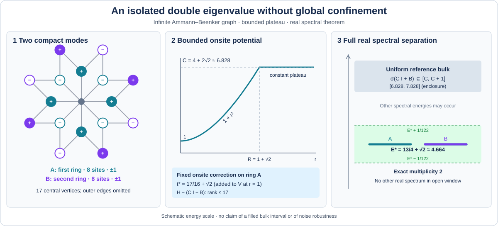
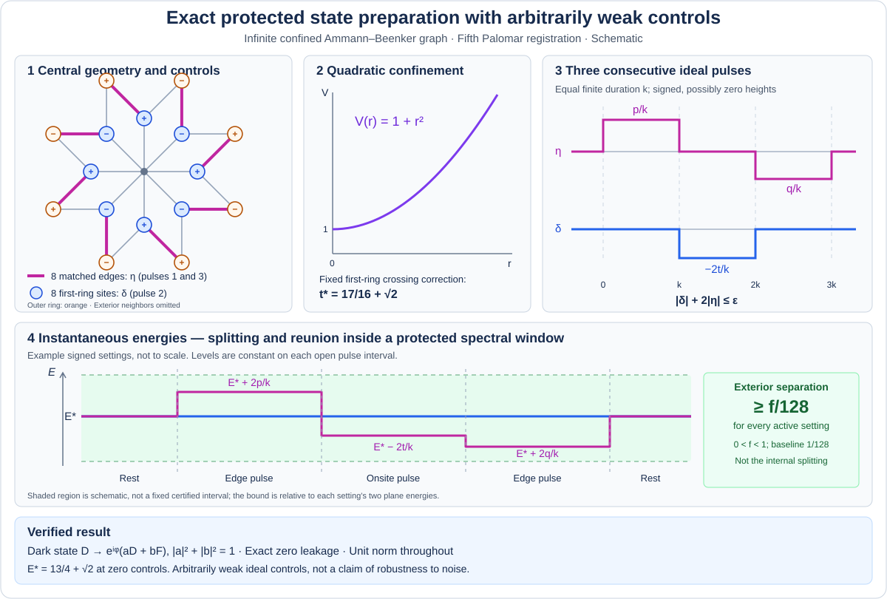

# Spectral Geometry

**A research program in Lean 4 and Mathlib studying how local changes to
operators on infinite geometric graphs affect their energy levels and the
zeros of analytic functions built from those levels.**

## Table of contents

- [Executive summary](#executive-summary)
  - [Exactly two localized crossing states](#exactly-two-localized-crossing-states)
  - [A one-edge change splits two energy levels](#a-one-edge-change-splits-two-energy-levels)
  - [Exact leakage-free quantum state preparation](#exact-leakage-free-quantum-state-preparation)
  - [Spectral protection during coordinated control](#spectral-protection-during-coordinated-control)
  - [Exact protected state preparation with arbitrarily weak controls](#exact-protected-state-preparation-with-arbitrarily-weak-controls)
  - [An isolated double eigenvalue without global confinement](#an-isolated-double-eigenvalue-without-global-confinement)
- [Visual summary of the sixth theorem](#visual-summary-of-the-sixth-theorem)
- [Visual summary of the fifth theorem](#visual-summary-of-the-fifth-theorem)
- [Research tracks and current priority](docs/research-tracks.md#research-tracks-and-current-priority)
- [Scientific audience and possible relevance](docs/scientific-audience.md#scientific-audience-and-possible-relevance)
- [Current status and verified milestones](docs/verified-milestones.md#current-status-and-verified-milestones)
- [1. Research program and geometric model](docs/research-program.md#1-research-program-and-geometric-model)
- [2. Canonical products and analytic foundations](docs/canonical-products.md#2-canonical-product-and-analytic-foundations)
- [3. Finite-dimensional geometric operators](docs/finite-dimensional-operators.md#3-finite-dimensional-geometric-operators)
- [4. Infinite-dimensional operators and spectral theory](docs/infinite-spectral-theory.md#4-infinite-dimensional-geometric-operators-and-spectral-theory)
  - [4.1–4.67. Infinite-dimensional spectral theory](docs/infinite-spectral-theory.md)
  - [4.68–4.79. Ammann–Beenker geometry and the compact crossing](docs/ammann-beenker-geometry.md)
  - [4.80–4.98. Single-edge control and spectral splitting](docs/single-edge-control.md)
  - [4.99–4.111. Coordinated quantum control and spectral protection](docs/coordinated-quantum-control.md)
  - **Ammann–Beenker model, crossing and controls**
    - [4.68–4.70. Graph construction and spectral response](docs/ammann-beenker-geometry.md#468-an-explicit-octagonal-cut-and-project-vertex-set)
    - [4.74–4.75. Localized modes and exact crossing](docs/ammann-beenker-geometry.md#474-compact-eigenvectors-on-the-infinite-natural-domain)
    - [4.78. Exactly two crossing states](docs/ammann-beenker-geometry.md#478-central-support-and-exact-multiplicity-of-the-infinite-crossing)
    - [4.79. Certified spectral gap](docs/ammann-beenker-geometry.md#479-a-conservative-quantitative-real-spectral-gap-at-the-crossing)
    - [4.80. Two ways to change the energies: ring parameter and connecting edge](docs/single-edge-control.md#480-first-exact-algebraic-results-for-controlling-the-two-compact-modes)
    - [4.81. Projection onto the two-mode space and external leakage](docs/single-edge-control.md#481-exact-qubitleakage-bookkeeping-after-a-temporary-pulse)
    - [4.85–4.88. Temporary edge pulses and switch-off bounds](docs/single-edge-control.md#485-uniform-post-pulse-leakage-without-a-perturbed-spectral-projector)
    - [4.89–4.91. Dark-state evolution and bright-state response](docs/single-edge-control.md#489-an-exact-complex-phase-schrödinger-trajectory-for-the-dark-mode)
  - **Quantitative spectral splitting, registration and coordinated control**
    - [4.93–4.96. From existence to quantitative bounds](docs/single-edge-control.md#493-verified-dark-simplicity-and-a-distinct-perturbed-spectral-level)
    - [4.97. Final L5 theorem: signed bright splitting](docs/single-edge-control.md#497-signed-shift-and-consolidated-infinite-operator-splitting)
    - [4.98. Palomar registration and independent verification](docs/single-edge-control.md#498-palomar-registration-signed-bright-splitting)
    - [4.99. Coordinated eight-edge matching and exact dark cancellation](docs/coordinated-quantum-control.md#499-coordinated-eight-edge-matching-and-exact-dark-cancellation)
    - [4.100. Exact invariant-plane control and Pauli generator algebra](docs/coordinated-quantum-control.md#4100-exact-invariant-plane-control-and-pauli-generator-algebra)
    - [4.101. Full Lie generation and constructive two-state rotations](docs/coordinated-quantum-control.md#4101-full-lie-generation-and-constructive-two-state-rotations)
    - [4.102. Exact natural-domain Schrödinger trajectories for both control axes](docs/coordinated-quantum-control.md#4102-exact-natural-domain-schrödinger-trajectories-for-both-control-axes)
    - [4.103. Exact identification of physical pulses with Pauli rotations](docs/coordinated-quantum-control.md#4103-exact-identification-of-physical-pulses-with-pauli-rotations)
    - [4.104. Continuous three-pulse protocol with exact zero leakage](docs/coordinated-quantum-control.md#4104-continuous-three-pulse-protocol-with-exact-zero-leakage)
    - [4.105. Exact arbitrary target preparation from dark without leakage](docs/coordinated-quantum-control.md#4105-exact-arbitrary-target-preparation-from-dark-without-leakage)
    - [4.106. Sharp coordinated-control norms and exact bounded perturbation](docs/coordinated-quantum-control.md#4106-sharp-coordinated-control-norms-and-exact-bounded-perturbation)
    - [4.107. Exact controlled plane energies and natural-domain reduction](docs/coordinated-quantum-control.md#4107-exact-controlled-plane-energies-and-natural-domain-reduction)
    - [4.108. Quantitative exclusion of exterior real spectral levels](docs/coordinated-quantum-control.md#4108-quantitative-exclusion-of-exterior-real-spectral-levels)
    - [4.109. Consolidated quantitative isolation of the controlled cluster](docs/coordinated-quantum-control.md#4109-consolidated-quantitative-isolation-of-the-controlled-cluster)
    - [4.110. Spectral protection during coordinated control](docs/coordinated-quantum-control.md#4110-spectral-protection-during-coordinated-control)
    - [4.111. Exact protected state preparation with arbitrarily weak controls](docs/coordinated-quantum-control.md#4111-exact-protected-state-preparation-with-arbitrarily-weak-controls)
- [5. Building and verification](docs/building-and-verification.md#5-building-and-verification)
- [6. Roadmap: both research tracks and open questions](docs/research-roadmap.md#6-roadmap-proof-status-and-next-steps)
  - [6.1–6.4. Original spectral and geometric program](docs/research-roadmap.md#61-p2--spectral-foundations-and-the-complex-resolvent-interface)
  - [6.4. L7 exact preparation verified; L6 preserved](docs/research-roadmap.md#64-p4--a-confined-ammannbeenker-model-and-a-finite-intervention)
  - [6.5–6.7. Relative products, finite patches and exploratory zeros](docs/research-roadmap.md#65-local-geometric-defects-and-relative-spectral-products)
  - [6.8. Scientific assessment and submission status](docs/research-roadmap.md#68-independent-statement-verification-and-research-interest-assessment)
  - [6.9. L8a: Quantitative spectral protection (verified; refinements open)](docs/research-roadmap.md#69-l8a--quantitative-spectral-protection-under-coordinated-controls-open)
  - [6.10. L9 — Independently controllable spectrally protected localized qubits (open)](docs/research-roadmap.md#610-l9--independently-controllable-spectrally-protected-localized-qubits-open)
- [7. Research methodology and maintenance rules](docs/maintenance-rules.md#7-research-methodology-and-maintenance-rules)

## Executive summary

We study how local changes affect waves in an infinite Ammann–Beenker network, a mathematical model with an octagonal structure.

### Exactly two localized crossing states

At a particular energy, the network has two localized wave patterns, which we call A and B. An earlier theorem, registered with Palomar on 6 November 2026 as [PALOMAR-2026-11-06-000012 (version 1)](https://palomar-registry.org/entry?id=PALOMAR-2026-11-06-000012&version=1), proved that these two patterns account for all independent states at that energy in the entire infinite network.

Further results proved in Lean establish that, at this special setting, no other real energy level lies within a distance of 1/128 of their common energy.

The exact multiplicity is the registered result; the quantitative baseline gap is a separate Lean-verified theorem.

### A one-edge change splits two energy levels

One way to change the energies is to change a parameter that affects the first ring of the network. This raises or lowers the energy of A by exactly the parameter change, while leaving the energy of B unchanged. Both patterns remain exact eigenstates of the infinite system, without spreading outside their original localized forms. The spectral gap was proved at the original setting; for sufficiently small changes to this parameter, separation from the other energy levels also follows from the general eigenvalue-stability estimates already established in Lean.

Another way is to change the strength of a single edge connecting the two rings. Here the situation is more subtle. One combination of the original patterns, called the dark state, remains protected at the original energy. The other, called the bright state, responds to the change and interacts with the rest of the infinite network.

The second theorem, separately registered with Palomar on 23 November 2026 as [PALOMAR-2026-11-23-000017 (version 1)](https://palomar-registry.org/entry?id=PALOMAR-2026-11-23-000017&version=1), proves what actually happens in this second case. For a sufficiently small, nonzero edge change, there are exactly two distinct real energy levels represented by eigenvectors in a specified narrow range. One remains fixed, while the other moves upward when the edge is strengthened and downward when it is weakened. Each level has only one independent wave pattern.

The theorem also gives two precise numerical guarantees. The moving energy differs from the original energy plus one quarter of the edge change by no more than 112 times the square of that change. For a normalized wave at the moving energy, the size of the part extending beyond the original two-state space is at most 64 times the square root of 7, multiplied by the absolute size of the edge change.

This means that we can make the external part of the moving wave as small as desired while keeping the two energy levels distinct. These are exact results for the infinite system, not predictions from a simplified two-state model.

What happens if the edge change is temporary? Separate theorems, already proved in Lean, study an edge change applied for a period of time and then switched off. They give a bound on the wave's component outside the original two-state space: no more than 512 times the absolute size of the edge change, multiplied by the initial wave's size. This bound is independent of the duration of the pulse and of the time elapsed after switching it off.

These temporal conclusions are conditional: they assume that the supplied evolution preserves norms, preserves the operator's mathematical domain, and commutes with the relevant Hamiltonian during each stage. A general physical quantum propagator has not yet been constructed in this formalization.

The results fit together in a natural way. Changing the first-ring parameter offers an exact way to adjust the relative energies of the two original patterns without changing their shapes. Changing the connecting edge produces a genuine energy separation involving a bright-derived state, while the associated spreading into the infinite network can be kept small. The temporal results complement these spectral findings by showing that, under suitable evolution assumptions, the wave remains close to the original two-state space during and after a temporary edge change.

The exact signed spectral-splitting theorem is the second registered result; the baseline gap and conditional pulse bounds are not independently selected as standalone statements in any of the five registrations.

### Exact leakage-free quantum state preparation

We study a particular infinite Ammann–Beenker network, an octagonal mathematical graph with a confining potential. At a special energy it supports two localized wave patterns, A and B. Their normalized sum is called the dark state, and their normalized difference the bright state. The result registered as [PALOMAR-2026-11-06-000012 (version 1)](https://palomar-registry.org/entry?id=PALOMAR-2026-11-06-000012&version=1) proves that the two patterns account for all independent states at the crossing energy, and the result registered as [PALOMAR-2026-11-23-000017 (version 1)](https://palomar-registry.org/entry?id=PALOMAR-2026-11-23-000017&version=1) proves that changing a single edge splits this energy while allowing a small part of the bright-derived wave to spread into the rest of the network.

The new theorem asks whether we can prepare any desired mixture of the dark and bright waves without any such spreading. The answer is yes, under two independently adjustable signed real controls. The first changes a common parameter on the eight vertices of the first ring, shifting the energy of A relative to B. The second changes eight genuine edges connecting corresponding sites on the two rings, all by the same amount. These edges are distinct and share no endpoints. Their combined effect leaves the dark state unchanged and shifts the bright energy by twice the edge-strength change. Both controls preserve the original two-state space exactly on the full infinite graph.

The controls change the state in different ways: one mixes the dark and bright amplitudes, while the other changes their relative phase. By applying three consecutive pulses of unit duration (edge control, first-ring control, edge control), we can start with the dark wave and reach any chosen normalized pair of complex dark and bright amplitudes, including the pure bright wave. The final state differs from the desired state only by a common phase of modulus one, which does not change the relative amplitudes or the physical ray. The accumulated phase is given explicitly. The pulse strengths can be chosen from the magnitudes and phases of the desired amplitudes.

The result concerns the actual infinite operator, not a numerical simulation or a two-state approximation. Lean constructs a continuous time-dependent state as two real square-summable graph vectors representing its real and imaginary parts. These vectors lie in the natural domain of the unbounded Hamiltonian at every time and satisfy the coupled full-graph Schrödinger equations during each open pulse interval. The total squared complex norm stays exactly one. The part of each vector outside the original localized two-state space is exactly zero throughout the protocol, including both switching times and the final state. No small-control assumption or pre-existing time-evolution map is required. The Hamiltonian may change discontinuously at the switches, so differentiability at the switching instants is not asserted.

This is an existence theorem for preparation from the dark state in this specified compact plane with independently tunable signed controls. It does not construct a general complex unitary propagator for arbitrary initial data on the infinite graph, prove phase-sensitive equality without a common phase, claim an optimal number of controlled edges, or establish experimental feasibility or originality. The earlier single-edge spectral-splitting theorem is a separate result.

**Palomar registration.** The third result was registered on 25 November 2026 as [PALOMAR-2026-11-25-000001 (version 1)](https://palomar-registry.org/entry.html?id=PALOMAR-2026-11-25-000001&version=1). Full Lean verification, independent statement comparison and Challenge renderability passed. The automated editorial review reported no identified problems with the selected statements, their presentation or their research relevance. The first two Palomar registrations remain unchanged. Registration establishes mechanical verification of selected statements, not human peer review, novelty or experimental feasibility.

### Spectral protection during coordinated control

An infinite Ammann–Beenker network is a mathematical graph with octagonal geometry. In this particular network, two localized wave patterns share a special energy, as established in [PALOMAR-2026-11-06-000012 (version 1)](https://palomar-registry.org/entry?id=PALOMAR-2026-11-06-000012&version=1). [PALOMAR-2026-11-23-000017 (version 1)](https://palomar-registry.org/entry?id=PALOMAR-2026-11-23-000017&version=1) describes how changing a single edge splits their energy. [PALOMAR-2026-11-25-000001 (version 1)](https://palomar-registry.org/entry.html?id=PALOMAR-2026-11-25-000001&version=1) shows how two coordinated controls can prepare any normalized mixture of the two patterns, up to a common phase, without leakage. The present theorem asks whether their energies can also remain separated from all the other energies while those controls are active.

The first control changes a common onsite parameter on eight first-ring vertices by a signed amount δ. The second changes eight distinct inter-ring edges, with no shared endpoints, by a signed amount η. The two localized patterns span a space that both controls preserve exactly. Its two energy levels have midpoint E* + δ/2 + η, where E* is their original common energy, and half-spacing s = √(δ²/4 + η²). Both levels have genuine nonzero eigenvectors of the full infinite operator; they coincide only when both controls vanish. The orthogonal complement is also preserved on the natural operator domain.

At zero control, the certified gap around E* is 1/128. Write ρ = |δ| + 2|η| for the combined control size. The new theorem proves that if ρ/2 + s is less than 1/128, the complete real spectrum contains exactly the two controlled energies in the closed interval between them. Each is separated from every other real spectral energy by at least 1/128 − ρ/2 − s, which is strictly positive. Every eigenvector at either controlled energy lies entirely in the original localized space. The case of coincident energies at zero control is included.

Since s is at most ρ/2, the simpler condition ρ < 1/128 also guarantees protection, with separation at least 1/128 − ρ. This includes either control acting alone, with |δ| < 1/128 or |η| < 1/256, respectively. These bounds are sufficient, not claimed optimal.

The result is proved in Lean for the full infinite operator with its confining potential and natural domain, not for a finite sample or a two-state approximation. It adds a quantitative energy gap to exact geometric decoupling. It provides a foundation for studying imperfect controls, but does not prove noise tolerance, arbitrary-strength protection, experimental feasibility or general quantum dynamics.

The research direction was conceived and directed by Alessandro Odasso, who is not a mathematician. According to the maintainer, AI generated the mathematical proofs and Lean formalizations under his direction. The originality and scientific significance of these results have not yet been independently assessed.

**Palomar registration.** The fourth result was registered on 26 November 2026 as [PALOMAR-2026-11-26-000015 (version 1)](https://palomar-registry.org/entry?id=PALOMAR-2026-11-26-000015&version=1).

### Exact protected state preparation with arbitrarily weak controls

Can we prepare a chosen quantum state using very weak controls while keeping the two energy levels of its supporting space separated from the rest of an infinite network? For the particular confined Ammann–Beenker graph studied here, the answer is yes.

The first registered result, [PALOMAR-2026-11-06-000012 (version 1)](https://palomar-registry.org/entry?id=PALOMAR-2026-11-06-000012&version=1), establishes exactly two independent localized states at a common energy. A separate Lean theorem certifies a gap of 1/128 from all other real spectral energies at that setting. [PALOMAR-2026-11-23-000017 (version 1)](https://palomar-registry.org/entry?id=PALOMAR-2026-11-23-000017&version=1) shows how changing a single edge splits their energy. [PALOMAR-2026-11-25-000001 (version 1)](https://palomar-registry.org/entry.html?id=PALOMAR-2026-11-25-000001&version=1) establishes exact preparation without leakage using two coordinated controls, and [PALOMAR-2026-11-26-000015 (version 1)](https://palomar-registry.org/entry?id=PALOMAR-2026-11-26-000015&version=1) establishes spectral protection for sufficiently weak ideal controls. The new theorem brings exact preparation and spectral protection together.

The dark and bright states are the normalized sum and difference of the two original localized patterns. Starting from the dark state, choose any normalized complex superposition of these states, including either state alone. Also choose any positive control-strength limit ε and any fraction f strictly between zero and one of the certified gap to retain (for example, 99%). The theorem constructs three consecutive pulses of the same finite duration that reach the chosen state exactly up to a common phase of modulus one, which does not change the physical ray.

In each of the first and third pulses, all eight inter-ring edges are changed by a common signed amount, which may differ between the two pulses. The middle pulse changes a common onsite parameter at eight first-ring vertices. By making the pulses longer and reducing their strengths in inverse proportion, we preserve the desired rotation while making the combined control size |δ| + 2|η| at most ε, where δ is the onsite change and η the edge-strength change.

Throughout the protocol the state remains normalized, with exactly zero leakage outside the original two-state space, including at both switching times. In each of the three control settings, each of the two localized energy levels is separated from every real spectral energy outside those levels by at least f/128. Every eigenvector at either level is confined to the original space, and there are no other real spectral energies between them. The two levels may coincide when both controls vanish. The theorem gives an explicit duration and common phase.

This is an exact result for the unbounded Hamiltonian on the full infinite graph, not a two-state approximation or a finite simulation. The constructed state is continuous, its real and imaginary parts lie in the natural operator domain, and it satisfies the full Schrödinger equations on each open pulse interval. Differentiability at the switches is not asserted. The result does not claim a general full-space quantum propagator, arbitrary-target preparation at zero control strength, retention of the entire certified gap, robustness to noise or imperfect coordination, optimal pulse durations, or experimental feasibility.

The substantive proof and all 19 selected candidate propositions passed full Lean verification and independent statement comparison using the Lean default, NanoDa and con-ron kernels. Palomar mechanical verification and Challenge renderability passed, and the automated editorial review identified no blocking problem. Independent human peer review and assessment of novelty are not claimed.

**Palomar registration.** The fifth result was registered on 27 November 2026 as [PALOMAR-2026-11-27-000003 (version 1)](https://palomar-registry.org/entry.html?id=PALOMAR-2026-11-27-000003&version=1).

### An isolated double eigenvalue without global confinement

Can two exactly localized states remain isolated in energy if the potential stops growing away from their center? For the specific infinite Ammann–Beenker graph studied here, the answer is yes. This result replaces the growing radial potential of the earlier theorems with a bounded potential that is constant far from the origin, without losing either the two-state degeneracy or its spectral protection.

The graph is defined by projecting admitted points of a four-dimensional integer lattice into the plane, using an octagonal acceptance window. Edges join admitted lattice points differing by a signed coordinate unit vector. The interaction B is the positive graph Laplacian with edge weight 1/16, acting on the real square-summable states of the entire infinite graph. No finite sample or artificial boundary is introduced.

The original onsite potential 1 + r², where r is the distance from the origin, is now truncated to V(r) = min(1 + r², C), with C = 4 + 2√2 (approximately 6.828). A fixed onsite correction of 17/16 + √2 is retained on the eight vertices of the first ring. The resulting Hamiltonian is a bounded self-adjoint operator defined on the whole real Hilbert space. Outside the seventeen vertices of the central sector, the onsite value is exactly C.

Two compact states, A and B, have alternating amplitudes +1 and −1 on their respective eight-site rings and vanish everywhere else. They are orthogonal, each has squared norm eight, and both are exact eigenvectors at E* = 13/4 + √2 (approximately 4.664). The theorem proves that the entire eigenspace at E* has dimension exactly two: every state at that energy is a linear combination of A and B. Moreover, every other energy in the full real spectrum lies at distance at least 1/122 from E*. This excludes not only other eigenvalues but also any non-discrete real spectral energies within the open protected window. The radius is a rigorous lower bound, not a claimed exact gap.

There is a useful comparison with the uniform reference operator C I + B, called the bulk here. Its entire real spectrum lies in [C, C + 1], strictly above E*. The actual Hamiltonian differs from this reference only by a perturbation supported on the central sector, whose range has dimension at most seventeen. The enclosure does not say that the bulk fills the interval or that the full Hamiltonian has no other levels below it.

Why is this interesting? Localized states in an infinite network need not depend on confinement throughout the network. Here a strictly local modification of a uniform background produces an exactly two-dimensional isolated energy space, with a quantitative guarantee valid on the full infinite graph. Unlike the earlier confined model, the proof does not require a compact resolvent or a discrete spectrum. This provides a mathematical starting point for investigating separated localized two-state systems in the same network. It does not yet establish multiple independently controllable qubits, state preparation for the plateau Hamiltonian, noise robustness, or experimental feasibility.

The substantive theorem and its supporting results have passed Lean and Mathlib verification. Independent Comparator verification of this sixth candidate is pending; neither independent human peer review nor a novelty or priority assessment is claimed.

## Visual summary of the sixth theorem

**Figure.** The actual central graph and its two alternating compact-mode patterns are shown on the left (exterior neighbors omitted). The radial onsite baseline becomes constant at C; the first-ring crossing correction is shown separately. The two modes share E*, with a certified radius 1/122 free of other real spectral energies. The uniform reference bulk lies in [C, C + 1]. The energy panel is schematic and does not assert that the rest of the spectrum is empty.

## Visual summary of the fifth theorem

**Figure.** Schematic illustration of the verified protected exact-preparation protocol.
The central patch shows the actual two eight-site supports and the eight matched
inter-ring edges (magenta); the other central edges are gray and the exterior
neighbors are omitted. The quadratic baseline potential is supplemented by the
fixed crossing correction on the first ring. Three consecutive equal-duration
pulses act on the matched edges, the first-ring onsite values, and the matched
edges again. Pulse heights are illustrative and may be signed or zero. The
instantaneous plane energies shown correspond to each constant control setting;
after switching off the controls both return to the common energy E*.
The certified separation from all other real spectral energies is at least
f/128 in each setting, not the internal level spacing. The state is prepared
exactly from dark up to a common phase, with zero leakage throughout.
No noise robustness or differentiability at switches is asserted.

## Detailed section index

All numbered sections and historical links

- [1.1. The research question](docs/research-program.md#11-the-research-question)
- [1.2. First substantive milestone: finite-coordinate observation](docs/research-program.md#12-first-substantive-milestone-finite-coordinate-observation)
- [1.3. The operator and its geometric inputs](docs/research-program.md#13-the-operator-and-its-geometric-inputs)
- [1.4. Confinement, observation and local changes](docs/research-program.md#14-confinement-observation-and-local-changes)
- [2.1. Verified analytic core](docs/canonical-products.md#21-verified-analytic-core)
- [2.2. A common analytic coordinate for geometric operators](docs/canonical-products.md#22-a-common-analytic-coordinate-for-geometric-operators)
- [2.3. Target: a relative product for a finite geometric defect](docs/canonical-products.md#23-target-a-relative-product-for-a-finite-geometric-defect)
- [2.4. Entire products, exact zeros and their orders](docs/canonical-products.md#24-entire-products-exact-zeros-and-their-orders)
- [2.5. Certified zero clusters from bounded operator error](docs/canonical-products.md#25-certified-zero-clusters-from-bounded-operator-error)
- [2.6. Scalar approximation near a multiple spectral zero](docs/canonical-products.md#26-scalar-approximation-near-a-multiple-spectral-zero)
- [3.1. Symmetry under controlled perturbations](docs/finite-dimensional-operators.md#31-symmetry-under-controlled-perturbations)
- [3.2. Positivity under controlled perturbations](docs/finite-dimensional-operators.md#32-positivity-under-controlled-perturbations)
- [3.3. Nonnegative energy from geometry](docs/finite-dimensional-operators.md#33-nonnegative-energy-from-geometry)
- [3.4. Strictly positive energies and eigenvalues](docs/finite-dimensional-operators.md#34-strictly-positive-energies-and-eigenvalues)
- [4.1. Square-summable states and the natural operator domain](docs/infinite-spectral-theory.md#41-square-summable-states-and-the-natural-operator-domain)
- [4.2. Density of the natural operator domain](docs/infinite-spectral-theory.md#42-density-of-the-natural-operator-domain)
- [4.3. Point eigenvalues and positivity](docs/infinite-spectral-theory.md#43-point-eigenvalues-and-positivity)
- [4.4. A sufficient growth condition for summable spectral levels](docs/infinite-spectral-theory.md#44-a-sufficient-growth-condition-for-summable-spectral-levels)
- [4.5. Power-law growth: the critical exponent one half](docs/infinite-spectral-theory.md#45-power-law-growth-the-critical-exponent-one-half)
- [4.6. Geometric interactions acting on infinite square-summable states](docs/infinite-spectral-theory.md#46-geometric-interactions-acting-on-infinite-square-summable-states)
- [4.7. Combining infinite onsite energies, interactions, and perturbations](docs/infinite-spectral-theory.md#47-combining-infinite-onsite-energies-interactions-and-perturbations)
- [4.8. Countably infinite geometric interactions with summable weights](docs/infinite-spectral-theory.md#48-countably-infinite-geometric-interactions-with-summable-weights)
- [4.9. Bounded-degree local interactions from infinite matching families](docs/infinite-spectral-theory.md#49-bounded-degree-local-interactions-from-infinite-matching-families)
- [4.10. Lower bounds on point eigenvalues of infinite local operators](docs/infinite-spectral-theory.md#410-lower-bounds-on-point-eigenvalues-of-infinite-local-operators)
- [4.11. Stable spectral lower bounds under signed bounded perturbations](docs/infinite-spectral-theory.md#411-stable-spectral-lower-bounds-under-signed-bounded-perturbations)
- [4.12. Coercive energy and residual gap for infinite local operators](docs/infinite-spectral-theory.md#412-coercive-energy-and-residual-gap-for-infinite-local-operators)
- [4.13. Graph-norm control for infinite local operators](docs/infinite-spectral-theory.md#413-graph-norm-control-for-infinite-local-operators)
- [4.14. Closed graphs of the onsite and full infinite local operators](docs/infinite-spectral-theory.md#414-closed-graphs-of-the-onsite-and-full-infinite-local-operators)
- [4.15. Explicit adjoint characterization and self-adjointness criterion](docs/infinite-spectral-theory.md#415-explicit-adjoint-characterization-and-self-adjointness-criterion)
- [4.16. Solving a real shifted onsite resolvent equation](docs/infinite-spectral-theory.md#416-solving-a-real-shifted-onsite-resolvent-equation)
- [4.17. Finite low-energy sectors under a proper onsite potential](docs/infinite-spectral-theory.md#417-finite-low-energy-sectors-under-a-proper-onsite-potential)
- [4.18. Compact resolvent of a proper onsite potential](docs/infinite-spectral-theory.md#418-compact-resolvent-of-a-proper-onsite-potential)
- [4.19. The bounded onsite resolvent is the shifted inverse on its natural domain](docs/infinite-spectral-theory.md#419-the-bounded-onsite-resolvent-is-the-shifted-inverse-on-its-natural-domain)
- [4.20. Compact resolvent under small bounded interactions and perturbations](docs/infinite-spectral-theory.md#420-compact-resolvent-under-small-bounded-interactions-and-perturbations)
- [4.21. Quantitative compact-resolvent bounds and sufficiently negative shifts](docs/infinite-spectral-theory.md#421-quantitative-compact-resolvent-bounds-and-sufficiently-negative-shifts)
- [4.22. Self-adjoint onsite and infinite local operators in Mathlib's partial-operator API](docs/infinite-spectral-theory.md#422-self-adjoint-onsite-and-infinite-local-operators-in-mathlibs-partial-operator-api)
- [4.23. Compact self-adjoint resolvents and their eigenspaces](docs/infinite-spectral-theory.md#423-compact-self-adjoint-resolvents-and-their-eigenspaces)
- [4.24. Eigenpair correspondence between the compact resolvent and the full operator](docs/infinite-spectral-theory.md#424-eigenpair-correspondence-between-the-compact-resolvent-and-the-full-operator)
- [4.25. Finite multiplicity and orthogonality of full local eigenvectors](docs/infinite-spectral-theory.md#425-finite-multiplicity-and-orthogonality-of-full-local-eigenvectors)
- [4.26. Fredholm spectral exhaustion for the nonzero local resolvent spectrum](docs/infinite-spectral-theory.md#426-fredholm-spectral-exhaustion-for-the-nonzero-local-resolvent-spectrum)
- [4.27. Completeness of genuine eigenvectors of the full infinite local operator](docs/infinite-spectral-theory.md#427-completeness-of-genuine-eigenvectors-of-the-full-infinite-local-operator)
- [4.28. A resolvent-norm exclusion zone for full-operator eigenvalues](docs/infinite-spectral-theory.md#428-a-resolvent-norm-exclusion-zone-for-full-operator-eigenvalues)
- [4.29. Isolation of nonzero points in the compact resolvent spectrum](docs/infinite-spectral-theory.md#429-isolation-of-nonzero-points-in-the-compact-resolvent-spectrum)
- [4.30. Isolation and local finiteness of genuine full-operator eigenvalues](docs/infinite-spectral-theory.md#430-isolation-and-local-finiteness-of-genuine-full-operator-eigenvalues)
- [4.31. Countability and a complete (unordered) listing of full-operator eigenvalues](docs/infinite-spectral-theory.md#431-countability-and-a-complete-unordered-listing-of-full-operator-eigenvalues)
- [4.32. The full real bounded-inverse spectrum on the natural domain](docs/infinite-spectral-theory.md#432-the-full-real-bounded-inverse-spectrum-on-the-natural-domain)
- [4.33. Countable eigenvalue enumeration with eigenspace multiplicity tags](docs/infinite-spectral-theory.md#433-countable-eigenvalue-enumeration-with-eigenspace-multiplicity-tags)
- [4.34. Positive geometric multiplicity and exact tagged-spectrum coverage](docs/infinite-spectral-theory.md#434-positive-geometric-multiplicity-and-exact-tagged-spectrum-coverage)
- [4.35. Completeness indexed by the full real bounded-inverse spectrum](docs/infinite-spectral-theory.md#435-completeness-indexed-by-the-full-real-bounded-inverse-spectrum)
- [4.36. Ordered finite spectral windows with exact multiplicity tags](docs/infinite-spectral-theory.md#436-ordered-finite-spectral-windows-with-exact-multiplicity-tags)
- [4.37. Globally ordered infinite spectrum with exact geometric multiplicities](docs/infinite-spectral-theory.md#437-globally-ordered-infinite-spectrum-with-exact-geometric-multiplicities)
- [4.38. Divergence to +∞ of the globally ordered full real spectrum](docs/infinite-spectral-theory.md#438-divergence-to--of-the-globally-ordered-full-real-spectrum)
- [4.39. Variational comparison and uniform real spectral gap for the full operator](docs/infinite-spectral-theory.md#439-variational-comparison-and-uniform-real-spectral-gap-for-the-full-operator)
- [4.40. Low-energy coordinate injection and eigenspace multiplicity counting](docs/infinite-spectral-theory.md#440-low-energy-coordinate-injection-and-eigenspace-multiplicity-counting)
- [4.41. Simultaneous spectral subspaces on the natural domain](docs/infinite-spectral-theory.md#441-simultaneous-spectral-subspaces-on-the-natural-domain)
- [4.42. Quantitative finite-sector observation and closedness](docs/infinite-spectral-theory.md#442-quantitative-finite-sector-observation-and-closedness)
- [4.43. Total low-energy counting with the original multiplicities](docs/infinite-spectral-theory.md#443-total-low-energy-counting-with-the-original-multiplicities)
- [4.44. Complete eigenbases with exact multiplicity tags](docs/infinite-spectral-theory.md#444-complete-eigenbases-with-exact-multiplicity-tags)
- [4.45. A variational characterization of the ordered levels](docs/infinite-spectral-theory.md#445-a-variational-characterization-of-the-ordered-levels)
- [4.46. Ordered onsite comparison and finite-sector response](docs/infinite-spectral-theory.md#446-ordered-onsite-comparison-and-finite-sector-response)
- [4.47. Existence and operator hypotheses along the perturbation](docs/infinite-spectral-theory.md#447-existence-and-operator-hypotheses-along-the-perturbation)
- [4.48. Full-spectrum summability and a controlled positive family](docs/infinite-spectral-theory.md#448-full-spectrum-summability-and-a-controlled-positive-family)
- [4.49. Full spectral products with exact geometric zero multiplicities](docs/infinite-spectral-theory.md#449-full-spectral-products-with-exact-geometric-zero-multiplicities)
- [4.50. Algebraic identities for indexed spectral points](docs/infinite-spectral-theory.md#450-algebraic-identities-for-indexed-spectral-points)
- [4.51. Matching the variational levels to exact geometric zero orders](docs/infinite-spectral-theory.md#451-matching-the-variational-levels-to-exact-geometric-zero-orders)
- [4.52. Effective finite-sector displacement of full-product zeros](docs/infinite-spectral-theory.md#452-effective-finite-sector-displacement-of-full-product-zeros)
- [4.53. Ordered windows certified by neighboring levels](docs/infinite-spectral-theory.md#453-ordered-windows-certified-by-neighboring-levels)
- [4.54. Counting exact analytic orders on the complex line](docs/infinite-spectral-theory.md#454-counting-exact-analytic-orders-on-the-complex-line)
- [4.55. Small symmetric bounded errors: ordered levels, gap and summability](docs/infinite-spectral-theory.md#455-small-symmetric-bounded-errors-ordered-levels-gap-and-summability)
- [4.56. Full spectral zero-cluster certificates under operator error](docs/infinite-spectral-theory.md#456-full-spectral-zero-cluster-certificates-under-operator-error)
- [4.57. Sorted onsite enumeration from properness](docs/infinite-spectral-theory.md#457-sorted-onsite-enumeration-from-properness)
- [4.58. Positive-interaction gaps, summability and sharper spectral response](docs/infinite-spectral-theory.md#458-positive-interaction-gaps-summability-and-sharper-spectral-response)
- [4.59. Sharpened full-product zero response for positive interactions](docs/infinite-spectral-theory.md#459-sharpened-full-product-zero-response-for-positive-interactions)
- [4.60. Local zero certificates from scalar boundary error](docs/infinite-spectral-theory.md#460-local-zero-certificates-from-scalar-boundary-error)
- [4.61. Explicit inverse-square tail errors for canonical products](docs/infinite-spectral-theory.md#461-explicit-inverse-square-tail-errors-for-canonical-products)
- [4.62. Scalar approximation at full spectral zeros](docs/infinite-spectral-theory.md#462-scalar-approximation-at-full-spectral-zeros)
- [4.63. Finite disk zero counts and the argument principle](docs/infinite-spectral-theory.md#463-finite-disk-zero-counts-and-the-argument-principle)
- [4.64. Rouché conservation and exact local multiplicity](docs/infinite-spectral-theory.md#464-rouché-conservation-and-exact-local-multiplicity)
- [4.65. Exact approximation counts at full spectral zeros](docs/infinite-spectral-theory.md#465-exact-approximation-counts-at-full-spectral-zeros)
- [4.66. Numerical tail rates and finite-factor lower certificates](docs/infinite-spectral-theory.md#466-numerical-tail-rates-and-finite-factor-lower-certificates)
- [4.67. A numerical certificate for the complete linear onsite spectrum](docs/infinite-spectral-theory.md#467-a-numerical-certificate-for-the-complete-linear-onsite-spectrum)
- [4.69. Exact neighbors, parity matchings and the concrete Laplacian](docs/ammann-beenker-geometry.md#469-exact-neighbors-parity-matchings-and-the-concrete-laplacian)
- [4.70. A nonempty nine-level spectral response on the vertex graph](docs/ammann-beenker-geometry.md#470-a-nonempty-nine-level-spectral-response-on-the-vertex-graph)
- [4.71. Planar vertex counting and geometric inverse-square summability](docs/ammann-beenker-geometry.md#471-planar-vertex-counting-and-geometric-inverse-square-summability)
- [4.72. Exact geometric full products and nine-level zero response](docs/ammann-beenker-geometry.md#472-exact-geometric-full-products-and-nine-level-zero-response)
- [4.73. A radial gap and a stronger nine-level response](docs/ammann-beenker-geometry.md#473-a-radial-gap-and-a-stronger-nine-level-response)
- [4.75. A ring crossing and a single-edge change](docs/ammann-beenker-geometry.md#475-a-ring-crossing-and-a-single-edge-change)
- [4.76. The exact central sector and its boundary](docs/ammann-beenker-geometry.md#476-the-exact-central-sector-and-its-boundary)
- [4.77. The central crossing kernel and centrally supported eigenvectors](docs/ammann-beenker-geometry.md#477-the-central-crossing-kernel-and-centrally-supported-eigenvectors)
- [4.82. Uniform leakage estimate conditional on a nearby invariant spectral plane](docs/single-edge-control.md#482-uniform-leakage-estimate-conditional-on-a-nearby-invariant-spectral-plane)
- [4.83. From the certified 1/128 gap to a quantitative bound on nearby eigenvectors](docs/single-edge-control.md#483-from-the-certified-1128-gap-to-a-quantitative-bound-on-nearby-eigenvectors)
- [4.84. Why spectral isolation yields a residual bound: infinite-dimensional Parseval](docs/single-edge-control.md#484-why-spectral-isolation-yields-a-residual-bound-infinite-dimensional-parseval)
- [4.86. Residual conservation follows from Hamiltonian intertwining](docs/single-edge-control.md#486-residual-conservation-follows-from-hamiltonian-intertwining)
- [4.87. The actual selected-edge pulse Hamiltonian is self-adjoint on its natural real domain](docs/single-edge-control.md#487-the-actual-selected-edge-pulse-hamiltonian-is-self-adjoint-on-its-natural-real-domain)
- [4.88. A controlled pulse followed by free evolution after switching the edge off](docs/single-edge-control.md#488-a-controlled-pulse-followed-by-free-evolution-after-switching-the-edge-off)
- [4.90. Consolidated verified control checkpoint and outstanding dynamics](docs/single-edge-control.md#490-consolidated-verified-control-checkpoint-and-outstanding-dynamics)
- [4.91. Verified bright-amplitude generator identity with explicit leakage forcing](docs/single-edge-control.md#491-verified-bright-amplitude-generator-identity-with-explicit-leakage-forcing)
- [4.92. Earlier, unsubmitted Palomar candidate: exact dark protection and bright feedback](docs/single-edge-control.md#492-earlier-unsubmitted-palomar-candidate-exact-dark-protection-and-bright-feedback)
- [4.94. Two simple eigenvalues in a certified perturbed window](docs/single-edge-control.md#494-two-simple-eigenvalues-in-a-certified-perturbed-window)
- [4.95. Bright amplitude and quantitative exterior leakage](docs/single-edge-control.md#495-bright-amplitude-and-quantitative-exterior-leakage)
- [4.96. A sharp quadratic law for the actual moving level](docs/single-edge-control.md#496-a-sharp-quadratic-law-for-the-actual-moving-level)
- [Historical anchor: 498-palomar-candidate-signed-bright-splitting](docs/single-edge-control.md#498-palomar-candidate-signed-bright-splitting)
- [Historical anchor: 4100-proposed-invariant-plane-and-pauli-algebra-proofs-ci-pending](docs/coordinated-quantum-control.md#4100-proposed-invariant-plane-and-pauli-algebra-proofs-ci-pending)
- [6.2. P2 — Quantitative observation and control of low-energy levels](docs/research-roadmap.md#62-p2--quantitative-observation-and-control-of-low-energy-levels)
- [6.3. P3 — Full spectral products and their exact zero divisors](docs/research-roadmap.md#63-p3--full-spectral-products-and-their-exact-zero-divisors)
- [6.6. Certified finite-patch approximation and zero response](docs/research-roadmap.md#66-certified-finite-patch-approximation-and-zero-response)
- [6.7. Exploratory objectives: zero statistics and structural constraints](docs/research-roadmap.md#67-exploratory-objectives-zero-statistics-and-structural-constraints)
- [6.9. L8a — Quantitative spectral protection under coordinated controls (verified; refinements open)](docs/research-roadmap.md#69-l8a--quantitative-spectral-protection-under-coordinated-controls-verified-refinements-open)
- [4.92. Earlier, unsubmitted Palomar candidate (historical link)](docs/single-edge-control.md#492-earlier-unsubmitted-palomar-candidate-exact-dark-protection-and-bright-feedback)

