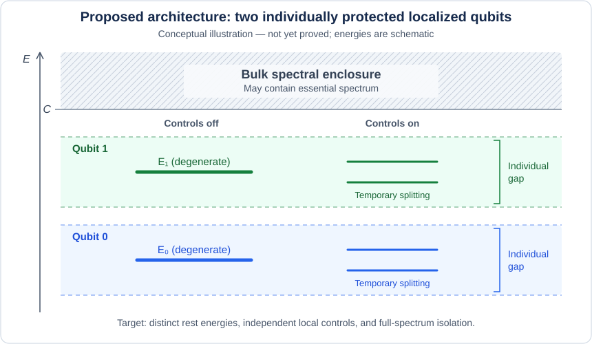

[← Main README and table of contents](../README.md) · [Track B roadmap](bright-spectral-splitting-roadmap.md) · [Research roadmap §6.10](research-roadmap.md#610-l9--independently-controllable-spectrally-protected-localized-qubits-open)

# L9 — Independently controllable spectrally protected localized qubits

**Status: active research; L9.1 bounded plateau isolation registered; L9.2 compact-mode replication registered; multi-qubit target not yet proved.** This is the active Track B
direction. Track A (spectral geometry and analytic zeros), the original
L6 single-edge approximate preparation, and L8b–L8e imperfect-control
research are preserved but deferred. All seven Palomar registrations and
the original confined Hamiltonian remain unchanged.

## Motivation and target architecture

The fifth registered result, [PALOMAR-2026-11-27-000003 (version 1)](https://palomar-registry.org/entry.html?id=PALOMAR-2026-11-27-000003&version=1),
establishes exact preparation from dark with arbitrarily weak ideal
controls, zero leakage and a prescribed fraction of the certified gap
on the original infinite confined graph (§4.111).

The immediate goal is to understand how far the **existing canonical plateau Hamiltonian** can take us without adding any new static onsite correction in a remote cell. The original tuned central pair, with its verified isolated double eigenvalue and gap, is preserved. In the constant exterior, the recurrent A/B configurations instead offer natural two-level systems with distinct energies. We will investigate these first rather than assume that each remote pair must be made degenerate.

The first target is one remote cell and then two well-separated remote cells. The ambitious target is any prescribed finite number N of independently addressable two-state planes. Orthogonal subspaces of a single-particle Hilbert space form a direct sum, not an N-qubit tensor product. Neither entanglement, a uniform protection gap as N grows, nor experimental feasibility is asserted.

The earlier engineered architecture with distinct degenerate rest energies is retained below as an alternative, not a prerequisite. The current analysis does not change the seven registered results.

## L9.1 — Bounded plateau model

- [x] Introduce a separate bounded onsite potential
  V_R(x) = 1 + min(|p(x)|², R²), with plateau C = 1 + R²,
  preserving the original definitions and the central first-ring
  crossing correction t* = 17/16 + sqrt(2).
- [x] Choose R large enough to preserve both central compact-mode
  equations; distinguish preservation of those eigenvectors from
  preservation of the original exact multiplicity and gap.
- [x] Prove boundedness, symmetry/self-adjointness on the full real
  Hilbert space and equality of the natural domain with the entire space.
- [x] Prove real bounded-inverse spectral isolation of the crossing,
  without assuming compact resolvent or eigenvalue exhaustion.
  Complexification is a separate extension if needed.
- [x] Establish the bulk enclosure sigma(C I + B) ⊆ [C,C+1] using the
  verified positivity and norm bound of the interaction B. Prove the
  appropriate finite-rank perturbation/essential-spectrum statements
  if needed; do not assume that the bulk fills the interval or is
  absolutely continuous.

**Verified foundation.** [`AmmannBeenkerPlateauOperator.lean`](../SpectralGeometry/AmmannBeenkerPlateauOperator.lean)
constructs the bounded self-adjoint real Hamiltonian for every height
C >= 1. The canonical height C = 4 + 4 alpha (alpha = sqrt(2)/2)
preserves the original potential on all seventeen central vertices
and is exactly constant everywhere else. The operator norm is at most
C + 1 + |t*|. The verified
[`AmmannBeenkerPlateauCrossing.lean`](../SpectralGeometry/AmmannBeenkerPlateauCrossing.lean)
transfers the original full-space action on centrally supported states
for C >= 5 and preserves both independent compact eigenvectors at
crossingEnergy. The verified module
[`AmmannBeenkerPlateauResidual.lean`](../SpectralGeometry/AmmannBeenkerPlateauResidual.lean),
uses the central 1/24 bound, exterior barrier 2 and boundary coupling
1/4 to derive ||x|| <= 122 ||(H_C - E*)x|| for orthogonal states on
the old dense natural domain when C >= canonicalPlateauHeight.
The verified [`AmmannBeenkerPlateauMultiplicity.lean`](../SpectralGeometry/AmmannBeenkerPlateauMultiplicity.lean)
extends this bound to the entire Hilbert space using density and
continuity of the compact projection, then identifies the full
crossing eigenspace with the two-dimensional compact plane.
The full-space estimate and exact geometric multiplicity two are now
Lean-verified. The verified modules
[`BoundedSelfAdjointInverse.lean`](../SpectralGeometry/BoundedSelfAdjointInverse.lean)
and [`AmmannBeenkerPlateauSpectrum.lean`](../SpectralGeometry/AmmannBeenkerPlateauSpectrum.lean)
use closed range, self-adjointness and the reducing compact projection
to obtain bounded invertibility of the regularized residual and
exclude every different real spectral energy at distance < 1/122.
These full real spectral results are Lean-verified. The verified
[`AmmannBeenkerPlateauBulk.lean`](../SpectralGeometry/AmmannBeenkerPlateauBulk.lean)
proves the uniform bulk enclosure, finite-rank defect of rank at most
17 and a bundled isolated-double-eigenvalue theorem. No claim about the exact essential spectrum is made.

The sixth registered result focuses on the concrete
bounded plateau model, exact double eigenvalue, full real spectral
gap and finite-rank bulk comparison. Aim for the Registry's preferred
300-line / 32 KiB Challenge review surface using standalone concrete
coordinate definitions; the hard limits are 1,000 lines / 100 KiB.
The standalone Challenge contains 281 lines and 12547 UTF-8 bytes. All 13 selected propositions passed independent Comparator verification with the Lean default, NanoDa and con-ron kernels. Palomar mechanical verification and Challenge renderability passed, and the automated editorial review identified no blocking problem. Registered on 27 November 2026 as [PALOMAR-2026-11-27-000042 (version 1)](https://palomar-registry.org/entry.html?id=PALOMAR-2026-11-27-000042&version=1). All earlier registered packages remain unchanged.

## L9.2 — Recurrence of compact-mode patches

**Verified recurrence and finite separation (§4.113).** [`AmmannBeenkerPatchRecurrence.lean`](../SpectralGeometry/AmmannBeenkerPatchRecurrence.lean) proves exact boundary avoidance, eventual preservation of all admission and exclusion decisions in any finite lift set, and arbitrary finite families of remote mutually separated centers with disjoint translated lift sets. Full Lean verification and independent comparison of the seventh registered result passed. The concrete two-step candidate neighborhood and full neighbor correspondence in [`AmmannBeenkerPatchNeighborhood.lean`](../SpectralGeometry/AmmannBeenkerPatchNeighborhood.lean) are now Lean-verified. Full-graph compact-mode transfer is Lean-verified in [`AmmannBeenkerTranslatedModes.lean`](../SpectralGeometry/AmmannBeenkerTranslatedModes.lean); preservation of inner products and the bundled finite family theorem are Lean-verified in [`AmmannBeenkerReplicatedPairs.lean`](../SpectralGeometry/AmmannBeenkerReplicatedPairs.lean).

- [x] Prove recurrence for the exact cut-and-project window and lattice
  coordinates of the implemented graph, for any finite lift set.
- [x] Prove arbitrary finite families with separated centers and disjoint
  complete translated lift sets.
- [x] Certify the concrete candidate neighborhood pattern, including all
  neighboring sites required for cancellation and control.
- [x] Construct arbitrarily many mutually separated translated
  patches outside a prescribed radius, with disjoint supports and
  control neighborhoods. A finite patch illustration is not a proof.
- [x] Transfer the full-space compact-mode equations
  L a_j = (3/16) a_j and L b_j = (1/4) b_j.
- [x] Certify preservation of orthogonality and squared norms 8. On a uniform plateau their prospective energies
  are C+3/16 and C+1/4, respectively, not a degenerate pair.
  Infinite multiplicity at each common plateau energy is a consequence
  to formalize in the new L9.3–L9.4 natural architecture.

The bundled theorem `exact_recurrent_compact_mode_pairs` certifies 2N mutually orthogonal nonzero compact eigenvectors with disjoint complete candidate neighborhoods for arbitrary finite N. All 16 selected propositions passed independent comparison with the Lean default, NanoDa and con-ron kernels; the seventh result is registered as [PALOMAR-2026-11-27-000067 (version 1)](https://palomar-registry.org/entry.html?id=PALOMAR-2026-11-27-000067&version=1).

## L9.3 — Natural plateau pairs: exact energies and local completeness

**Core L9.3 verified: transfer and exact local classification on the actual remote plateau.** Keep the canonical Hamiltonian from §4.112 fixed: H_C = L + V_eff, where V_eff includes the original first-ring correction and equals C = 4 + 2 sqrt(2) off the central seventeen-site sector. L = (D - A)/16, with D the full graph degree diagonal and A the adjacency matrix. No remote wells or additional static onsite terms are introduced.

The registered L9.2 theorem gives A/B compact eigenvectors a_j, b_j of L at 3/16 and 1/4, respectively, with squared norms eight and pairwise orthogonality. Whenever a translated patch is disjoint from the central defect, multiplication by V_eff on its supported vectors is exactly multiplication by C. Thus the following identities are direct mathematical consequences of the existing results, now consolidated in Lean-verified declarations (not separately registered):

```math
H_C a_j=(C+3/16)a_j,\qquad H_C b_j=(C+1/4)b_j.
```

Here E_A = C + 3/16 and E_B = C + 1/4 are independent of j, and E_B - E_A = 1/16. In a globally uniform model C I + L, changing C only shifts the spectrum and contributes a common dynamical phase; C = 0 gives L itself. The canonical H_C is different from C I + L at its central defect, which must be included in any global spectral or dynamical argument.

- [x] Formalize the full-space transfer to the canonical plateau and exact orthogonality for arbitrary finite families outside the defect. Preserve the central pair at E*. The new [`AmmannBeenkerNaturalPlateauPairs.lean`](../SpectralGeometry/AmmannBeenkerNaturalPlateauPairs.lean) implements the exterior-support annihilation of the defect, exact bulk agreement, energy shift, radius-four separation and the bundled finite-family theorem `exact_recurrent_natural_plateau_pairs`. Full Lean verification passed (130 modules); the 16 previously selected Comparator propositions also passed.
- [x] Classify the supported eigenvectors on the exact seventeen-site cell, using the full degree diagonal, its finite interior block, and all exterior cancellation equations. Equivalently, for a supported eigenvector x, require both the interior eigenvalue equation and zero boundary coupling. Do not infer completeness from the finite principal block alone. The new [AmmannBeenkerNaturalCellCompleteness.lean](../SpectralGeometry/AmmannBeenkerNaturalCellCompleteness.lean) implements the eight exterior witnesses, alternating amplitude constraints, and classification at every real energy for the original cell under L. Full Lean verification passed (131 modules). Reverse translation and remote plateau classification are implemented in [AmmannBeenkerNaturalRemoteCompleteness.lean](../SpectralGeometry/AmmannBeenkerNaturalRemoteCompleteness.lean), with full Lean verification passed (132 modules).
- [x] Determine whether the only supported eigenvectors, across all energies, are scalar multiples of A or B, and whether each supported eigenspace at E_A or E_B has dimension one. If true, their span is exactly the two-dimensional space generated by eigenvectors supported in the cell. This is not an eigenspace of multiplicity two at a single energy. For the original cell under L, Lean now proves that every nonzero supported eigenvector is a nonzero scalar multiple of A at 3/16 or B at 1/4; no other energy or direction is possible. The classification for the actual remote plateau is also Lean-verified.
- [x] Transfer the classification to all exact recurrent patches via the existing neighborhood equivalence. Record the scope explicitly: support inside this cell is not the same as localization in a larger region or the dimension of a full-graph eigenspace.
- [ ] As a secondary geometry question, enumerate the next graph-distance shells and their full degrees, then test for other compact modes with exact boundary cancellation. A uniform degree alone does not establish an eigenvector. Treat exploratory calculations as unverified until proved.

## L9.4 — Spectral environment and the limits of protection

- [x] Formalize the consequence of arbitrary finite orthogonal replicas: each of E_A and E_B has infinite-dimensional eigenspace in the full canonical plateau operator and in the uniform bulk (at the corresponding energies). The new [AmmannBeenkerNaturalMultiplicity.lean](../SpectralGeometry/AmmannBeenkerNaturalMultiplicity.lean) proves infinite-dimensionality for both full eigenspaces of the actual plateau and any uniform bulk (including zero height); full Lean verification passed (133 modules). In particular, no individual remote two-state plane can have a positive full-spectrum separation from its entire orthogonal complement: that complement contains other eigenvectors at both energies. 
- [x] Certify explicit orthogonal partners for every prescribed recurring cell, at arbitrary separation, and the impossibility of a positive residual lower bound on the entire complement at either natural energy. Implemented in [AmmannBeenkerNaturalIsolationObstruction.lean](../SpectralGeometry/AmmannBeenkerNaturalIsolationObstruction.lean), full Lean verification passed (134 modules). Collective isolation of the full eigenspaces is not excluded.
- [x] Establish exact uniform spectral translation and equivalence of collective residual bounds at the shifted energy; bound any canonical collective residual gap by 1/16 using the other full eigenspace. Proved in [AmmannBeenkerNaturalCollectiveSpectrum.lean](../SpectralGeometry/AmmannBeenkerNaturalCollectiveSpectrum.lean), full Lean verification passed (135 modules). A positive lower bound or a proof of accumulation remains open.
- [ ] Distinguish the exact internal level splitting 1/16 from spectral gaps. Determine whether E_A and E_B are isolated spectral points of infinite multiplicity, embedded or accumulation points; investigate gaps between or around them and the distance to the spectrum outside their **full** eigenspaces. No positive collective gap is assumed.
- [x] Certify that every canonical plateau eigenspace at a real bulk resolvent energy has dimension at most the rank of the central defect, hence at most seventeen; in particular every infinite-dimensional plateau eigenspace lies at a bulk spectral point. Proved in [AmmannBeenkerNaturalDefectComparison.lean](../SpectralGeometry/AmmannBeenkerNaturalDefectComparison.lean), full Lean verification passed (136 modules). This does not identify the essential spectrum or resolve gaps inside the enclosure.
- [ ] Study the uniform bulk L and C I + L, the full canonical H_C and the finite-rank central defect separately. Establish any required essential-spectrum or bounded-inverse claims rigorously; the enclosure [C,C+1] does not imply an interval of spectrum or absence of internal gaps.
- [ ] Where appropriate, use exact local residuals, rigorous finite-region bounds, and full-space estimates with justified invertibility. Numerical spectra can guide conjectures but cannot certify absence of spectrum on the infinite graph.
- [ ] Identify what protection is available through exact local reducing planes even if a global gap is impossible for an individual cell. If a collective spectral gap exists, determine its scope and whether controls preserve it.

## L9.5 — Local addressing without additional static wells

**Active task.** The unresolved collective spectral gap question in L9.4 is retained, not assumed or declared solved. Ideal exact control may be established independently of it. The translated first-ring onsite projection and eight matched-edge corrections, geometry, and exact full-space two-mode action are Lean-verified in [AmmannBeenkerNaturalRemoteControls.lean](../SpectralGeometry/AmmannBeenkerNaturalRemoteControls.lean) (137 modules). The spatial selectivity, independently weighted finite-family operator and reducing-complement statements are Lean-verified in [AmmannBeenkerNaturalControlSelectivity.lean](../SpectralGeometry/AmmannBeenkerNaturalControlSelectivity.lean) (138 modules). Sharp control norms and exact drift compensation are Lean-verified in [AmmannBeenkerNaturalControlNorms.lean](../SpectralGeometry/AmmannBeenkerNaturalControlNorms.lean) (139 modules).

- [x] Translate the existing first-ring onsite control R_j and eight-edge matching control M_j to a remote recurrent cell. Prove the exact full-space actions, boundedness, norms and reducing-plane identities on the normalized A/B basis, including boundary and exterior action.
- [x] Derive the local driven two-state matrix with its nondegenerate rest drift diag(E_A,E_B): [[E_A+δ+η,−η],[−η,E_B+η]], verified on the full real Hilbert space.
- [x] Check independently whether the available controls generate the required two-state rotations; the compensated rotation identities and arbitrary target reachability from dark are Lean-verified.
- [x] Prove that local controls on one cell annihilate every other selected plane, including the central plane when the neighborhoods are disjoint. Prove joint reduction of the chosen finite family and its common orthogonal complement, with exact selectivity even when different cells share the same energies.
- [ ] Determine whether energy-selective addressing is unnecessary under ideal spatially local controls; assess control strengths against any spectral bounds that can actually be certified.

## L9.6 — Exact preparation under the natural energy splitting

**Active task.** [AmmannBeenkerNaturalPairDynamics.lean](../SpectralGeometry/AmmannBeenkerNaturalPairDynamics.lean) certifies exact bounded-operator real/imaginary Schroedinger trajectories for free evolution, pure onsite detuning and compensated inter-ring pulses, with normalization, support and relative phase identities (140 modules). The continuous three-pulse protocol, its support, conserved norm and differential equations on the three open intervals are Lean-verified in [AmmannBeenkerNaturalPulseComposition.lean](../SpectralGeometry/AmmannBeenkerNaturalPulseComposition.lean) (141 modules). The actual compensated rotation matrices, their phase-retaining endpoint and the bundled arbitrary normalized target preparation theorem from dark are Lean-verified in [AmmannBeenkerNaturalExactPreparation.lean](../SpectralGeometry/AmmannBeenkerNaturalExactPreparation.lean) (142 modules). The common-Hamiltonian trajectory lifting, exact spectator dynamics and sums of independently driven trajectories are implemented in [AmmannBeenkerNaturalFamilyDynamics.lean](../SpectralGeometry/AmmannBeenkerNaturalFamilyDynamics.lean), awaiting verification. The compensated route is not an arbitrarily weak control protocol.

- [x] Construct a rigorous protocol reaching any normalized complex superposition in one remote A/B plane from a specified initial state, up to global phase, with the 1/16 drift included.
- [x] Prove normalization, continuous full-space trajectories, the Schrödinger equations on open pulse intervals and exactly zero leakage, including switching times.
- [ ] Investigate arbitrary weakness of controls, pulse durations and any attainable spectral protection separately. Do not transfer the fifth registered theorem's prescribed gap fraction without proving appropriate hypotheses.
- [ ] Demonstrate preparation of one plane while other selected cells undergo only their known free evolution. Extend to two independently addressed cells and assess simultaneous versus sequential schedules.

## L9.7 — Free evolution, storage and perturbations

- [ ] With controls off, derive the exact evolution in a remote plane: its A/B amplitudes acquire phases exp(-i E_A t) and exp(-i E_B t). The relative phase rotates at angular frequency 1/16 in units with hbar = 1. There is no spreading under exact rest evolution, but a general superposition is not a stationary ray.
- [ ] Study known-phase tracking, refocusing or other storage strategies if needed. Compare the uniform-zero-potential model with the canonical plateau, retaining the central defect distinction.
- [ ] Distinguish exact invariance for ideal controls from robustness to onsite disorder, edge perturbations and imperfect addressing. Investigate leakage and mixing among equal-energy replicas, including perturbations not respecting local reduction. Establish bounds if possible rather than infer robustness from compact support.
- [ ] Identify concrete obstructions, and only then consider the smallest additional static local intervention that resolves them. A plateau or a tuned well is not assumed necessary for remote control.

## L9.8 — Arbitrary finite natural architecture and decision point

- [ ] Extend verified local classification, ideal control and exact preparation to arbitrary finite families on the same fixed canonical plateau when possible. State all separation, control and spectral hypotheses and any dependence on N.
- [ ] Compare the natural nondegenerate architecture against the alternative engineered architecture below, based on proved results rather than assumed requirements. If an essential objective fails, investigate minimal modifications before pursuing distinct degenerate rest energies.
- [ ] Consolidate Lean proofs and independent statement comparison before selecting a new registry candidate; examine related literature without claiming priority or hardware feasibility.

## Alternative architecture — engineered degenerate rest energies (deferred)

The previous L9.3–L9.8 proposal is retained here in full. Its individual spectral isolation and stationary-ray storage targets are stronger and different from exact local addressing in the natural plateau. Pursue this route if the natural architecture proves insufficient for the chosen application, not by default.



*Figure — Alternative engineered target, not yet proved: two degenerate pairs at distinct rest energies below the bulk enclosure, with individual positive spectral windows. This is not the energy diagram of the current natural plateau pairs.*

### Alternative L9.3 — Two degenerate pairs at distinct rest energies

- [ ] Construct central and remote pairs with disjoint support and
  energies E_0 ≠ E_1. For a translated A/B patch, a candidate onsite
  assignment on the two rings is E_j−3/16 and E_j−1/4, respectively.
  Prove the full eigenvector equations, not just compressed ones.
- [ ] Explore choosing E_j below C with appropriate local wells and
  exterior barriers; keeping a pure plateau without local tuning
  cannot in general produce the desired distinct degenerate pairs.
- [ ] Preserve the original central energy E_0 = 13/4 + sqrt(2)
  if possible. The chosen construction must be justified, not assumed.

### Alternative L9.4 — Individual full-spectrum isolation

- [ ] For each pair P_j prove exact dimension two of the eigenspace
  at E_j and an explicit positive lower bound g_j on the distance
  from E_j to the spectrum of the restriction to P_j's orthogonal
  complement, including all other pairs and the bulk.
- [ ] Develop a bounded-inverse or coercive/residual estimate with
  surjectivity justified by self-adjointness; excluding eigenvectors
  alone is insufficient when essential spectrum is possible.
- [ ] First try isolated finite defects below the bulk enclosure,
  finite-block certificates and controlled exterior coupling
  (e.g. a Schur complement or a suitable barrier estimate).
  Prove that unwanted defect states do not enter the chosen windows.
  If this fails, revise the potential or patch construction rather
  than presupposing the gap. Internal bulk gaps are a later option.

### Alternative L9.5 — Independent local controls

- [ ] Transfer each first-ring onsite control R_j and eight-edge
  matching M_j to the verified translated patch, and prove the
  exact reducing-plane action and operator norm estimates.
- [ ] Prove each control annihilates every other encoded plane and
  that the full family of planes and common exterior reduce all
  ideal Hamiltonians. Spatial disjointness alone is not sufficient
  unless the complete operator action is checked.
- [ ] Derive explicit joint control budgets guaranteeing separation
  of each active pair from the other pairs and full exterior,
  for concurrent as well as sequential settings if attainable.

### Alternative L9.6 — Protected arbitrary-target preparation

- [ ] Transfer the three-pulse Euler construction to each pair,
  starting from its dark state and reaching any normalized complex
  target up to a local common phase.
- [ ] Prove exact normalization, continuous full-space trajectories,
  Schrödinger equations on open pulse intervals and zero leakage
  throughout, including switches. Establish a schedule with
  arbitrarily weak controls and any prescribed fraction strictly
  between zero and one of each certified gap retained.
- [ ] Show that preparing one encoded plane leaves the other
  encoded rays unchanged. If simultaneous preparation is proved,
  distinguish relative phases between different planes from
  phases internal to each plane. A sequential schedule suffices
  for the first milestone.

### Alternative L9.7 — Switch-off and storage

- [ ] Prove that both levels of each pair coincide again at E_j
  when its ideal controls are off, with no residual control.
- [ ] Prove that each prepared ray is stationary under the rest
  Hamiltonian, up to exp(−i E_j t). Different E_j can generate
  relative phases between planes in a global direct-sum state.
  This is ideal storage, not a noise-resilience theorem.

### Alternative L9.8 — Arbitrary finite architecture

- [ ] Extend the construction and full-spectrum certificates to
  any finite N, with explicit patch placement, rest energies,
  potentials, gaps and control budgets.
- [ ] Consolidate the exact two-pair result first, then generalize
  only after all assumptions are discharged on the actual graph.
  Reuse the existing Lean proofs where applicable; verify new
  results with full Lean/Mathlib checks and independent statement
  comparison before considering a separate registry candidate.
- [ ] Assess related literature and independent research interest;
  do not infer novelty from formal verification.

## Working order and boundaries

L9.1 and L9.2 are registered and remain unchanged. L9.3's core transfer and exact local completeness on the seventeen-site cell are Lean-verified; larger-support geometry remains exploratory. L9.4 is the active task and investigates global multiplicity and the full spectral environment; L9.5–L9.8 address local control, preparation, storage, robustness and arbitrary finite families. No individual gap from equal-energy replicas can exist on the unmodified plateau. A collective gap, exact selective control and robustness are separate questions. The earlier tuned-defect architecture is deferred as an alternative. Track A's compact-resolvent and summability infrastructure is preserved; do not transfer those hypotheses to the bounded model without proof. No new theorem is claimed verified by this roadmap update.
